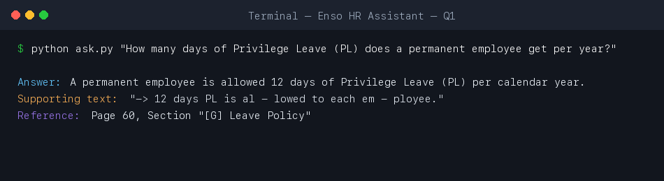
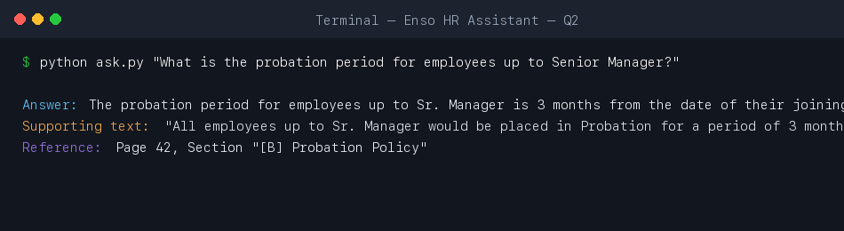
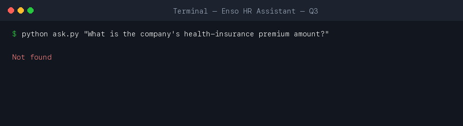
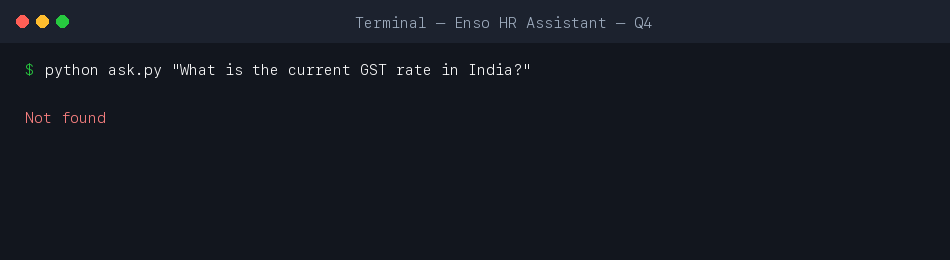
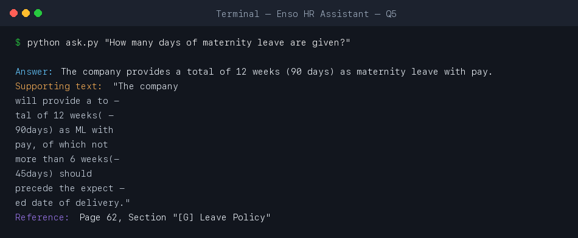

# HR Policy Assistant (RAG over Enso Group HR Manual)

A Retrieval-Augmented Generation (RAG) system built with **Python**, **LangChain**, and **ChromaDB**, powered by **Google Gemini** for embeddings and LLM answers. Designed to answer HR-related queries with strict grounding exclusively from `hr_manual.pdf` (Enso Group HR Policy Manual, 79 pages).

---

## 1. Architecture & Pipeline Flow

The answering logic ensures that every response is strictly fact-checked and grounded in the source manual:

```
[hr_manual.pdf] (79 Pages)
       │
       ▼
[PDF Ingestion & Preprocessing]
  • PyPDFLoader loads pages (1-indexed page numbering)
  • Noise cleaner removes headers/footers, non-printable symbols, fixes linebreaks
  • Regex extracts nearest policy/section headings: e.g., "[G] Leave Policy"
       │
       ▼
[Recursive Character Text Splitting]
  • chunk_size = 1000, chunk_overlap = 200
  • Metadata attached per chunk: {"source": "hr_manual.pdf", "page": X, "section": "Y"}
       │
       ▼
[Google Gemini Vector Embeddings]
  • Model: models/gemini-embedding-001 (768 dimensions)
  • Batched persistence with exponential backoff
       │
       ▼
[ChromaDB Vector Store] (./chroma_db)
       │
       ▼
[Similarity Search & Filtering]
  • similarity_search_with_score(k=4)
  • Chunks numbered [1] to [4] in prompt
  • Threshold gate: THRESHOLD = 0.70 (cosine distance; distances worse than 0.70 rejected)
       │
       ▼
[Gemini LLM Strict Grounding]
  • Model: models/gemini-3.1-flash-lite (temperature = 0)
  • Returns strict JSON schema:
    {
      "found": true/false,
      "answer": "...",
      "quote": "...",
      "chunk": <chunk_number>
    }
       │
       ▼
[Programmatic Verification]
  • Verbatim Quote Check: Normalized whitespace/casing check in cited chunk
  • Numeric Fact-Checking: Asserts all numbers in answer exist in the quote (no hallucinations or conversions)
       │
       ▼
[Formatted Output]
  • In-document: Answer, Supporting quote, Reference (Page X, Section "Y")
  • Out-of-document / Missing: Exactly "Not found"
```

---

## 2. Setup & Installation

### Prerequisites
- Python 3.10+ (tested on Python 3.12)
- Google Gemini API Key

### Installation

1. **Clone the repository:**
   ```bash
   git clone https://github.com/shxvaamm/GenAI-MidSem.git
   cd GenAI-MidSem
   ```

2. **Create and activate a virtual environment:**
   ```bash
   python3 -m venv venv
   source venv/bin/activate
   ```

3. **Install dependencies:**
   ```bash
   pip install -r requirements.txt
   ```

4. **Configure environment variables:**
   Create a `.env` file from `.env.example`:
   ```bash
   cp .env.example .env
   ```
   Add your Google Gemini API key:
   ```env
   GOOGLE_API_KEY=your_gemini_api_key_here
   THRESHOLD=0.70
   ```

5. **Build the Vector Store (Ingestion):**
   ```bash
   python ingest.py
   ```
   *Note: If `./chroma_db` is already created, you can skip re-ingestion.*

6. **Ask Questions:**
   - **Interactive CLI mode:**
     ```bash
     python ask.py
     ```
   - **Single question mode:**
     ```bash
     python ask.py "How many days of Privilege Leave (PL) does a permanent employee get per year?"
     ```

---

## 3. Exam Questions & Grounded Results

| # | Question | Answer | Supporting Quote | Reference |
| :-: | :--- | :--- | :--- | :--- |
| **1** | How many days of Privilege Leave (PL) does a permanent employee get per year? | A permanent employee is allowed 12 days of Privilege Leave (PL) per calendar year. | `"-> 12 days PL is al - lowed to each em - ployee."` | Page 60, Section "[G] Leave Policy" |
| **2** | What is the probation period for employees up to Senior Manager? | The probation period for employees up to Sr. Manager is 3 months from the date of their joining. | `"All employees up to Sr. Manager would be placed in Probation for a period of 3 months from the date of their joining."` | Page 42, Section "[B] Probation Policy" |
| **3** | What is the company's health-insurance premium amount? | Not found | *N/A (not in manual)* | *N/A* |
| **4** | What is the current GST rate in India? | Not found | *N/A (external topic)* | *N/A* |
| **5** | How many days of maternity leave are given? | The company provides a total of 12 weeks (90 days) as maternity leave with pay. | `"The company will provide a to - tal of 12 weeks( - 90days) as ML with pay, of which not more than 6 weeks(- 45days) should precede the expect - ed date of delivery."` | Page 62, Section "[G] Leave Policy" |

---

## 4. How "Not found" Works (Defense in Depth)

The system prevents hallucinations via a four-tier filtering mechanism:

1. **Similarity Score Threshold Gate (`THRESHOLD = 0.70`):**
   - ChromaDB returns cosine distance (0 is identical, higher is further).
   - If the best match distance is greater than `0.70` (e.g., GST rate returns `0.8114`, Capital of France returns `0.8421`), retrieval immediately terminates and returns `Not found` without invoking the LLM.

2. **LLM Explicit Grounding Instruction:**
   - If chunks pass the similarity threshold (e.g., health insurance has top score `0.6417` matching general employee benefits), the LLM inspects the numbered chunks. Because premium amounts are not mentioned anywhere in the document, it outputs `{"found": false}`.

3. **Verbatim Quote Substring Verification:**
   - The returned `"quote"` is checked programmatically against the chunk text using normalized whitespace and lowercasing. If the quote was hallucinated or altered, the response is discarded and returns `Not found`.

4. **Numeric Grounding Guard:**
   - Any number or numerical figure present in the `"answer"` must exist in the verbatim `"quote"`. This prevents unauthorized external calculations or conversions (e.g., converting 12 weeks into 90 days when not explicitly written in the quote). If an ungrounded number is found, it returns `Not found`.

---

## 5. Screenshots

### Question 1: Privilege Leave


### Question 2: Probation Period


### Question 3: Health-Insurance Premium Amount (Not Found)


### Question 4: Current GST Rate in India (Not Found)


### Question 5: Maternity Leave

